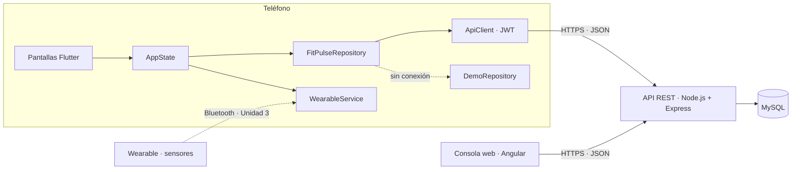
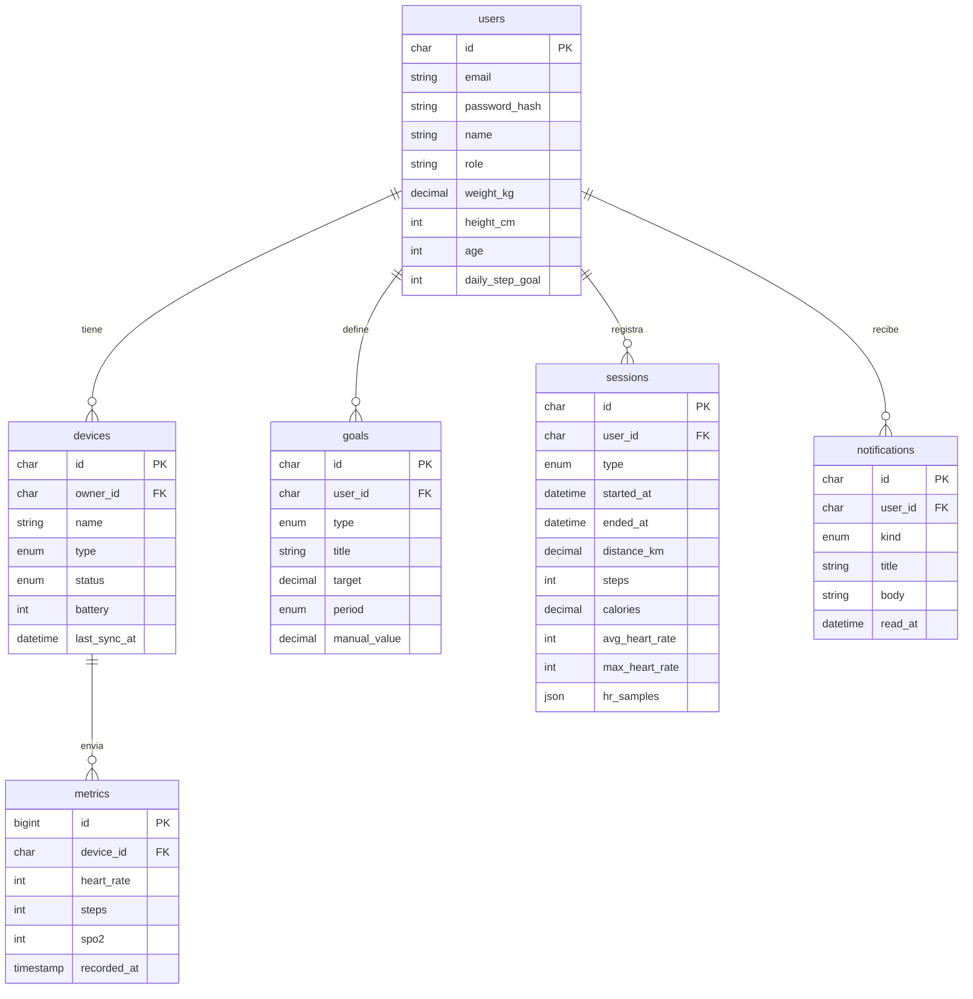

# FitPulse · Entregable 2 — Desarrollo de la aplicación móvil y backend

**Fecha de entrega:** octubre de 2026
**Repositorios:**
- App móvil (Flutter): https://github.com/2023371115-rgb/fitpulse-mobile
- Backend (Node.js + Express + MySQL): https://github.com/2023371115-rgb/fitpulse-backend

## Resumen

En esta unidad la app de FitPulse se desarrolló en Flutter a partir de los diseños de la Unidad 1 y se conectó con un backend en Node.js y Express que guarda la información en MySQL. El usuario puede registrarse, iniciar sesión, crear metas, registrar y consultar sesiones de actividad y ver sus métricas. Todo queda almacenado en la base de datos.

También quedó lista la estructura de comunicación con el wearable: una interfaz `WearableService`, de momento con una implementación simulada, cuyas lecturas ya viajan a la API y se guardan en MySQL. En la Unidad 3 solo se cambia esa implementación por la real (Bluetooth / Wear OS).

## Evidencias

| Evidencia solicitada | Dónde está | Cómo se comprueba |
|---|---|---|
| Aplicación móvil desarrollada con Flutter | `fitpulse-mobile/lib/` | `flutter run` · `dart analyze`: 0 problemas |
| Pantallas principales | `lib/screens/`: registro, inicio de sesión, inicio, perfil, metas, actividad física, sesiones, métricas, dispositivos y notificaciones | Navegación con 4 pestañas y pantallas secundarias |
| Registro e inicio de sesión | `lib/screens/auth_screen.dart` → `POST /api/auth/register` y `/api/auth/login` | Token JWT guardado en el teléfono; la sesión se recupera al abrir la app |
| Gestión de metas | `lib/screens/goals_screen.dart` → `GET/POST/PATCH/DELETE /api/goals` | El servidor calcula el avance de cada meta con las sesiones y el wearable |
| Registro y consulta de sesiones | `activity_screen.dart` y `sessions_screen.dart` → `POST/GET/DELETE /api/sessions` | Al terminar una actividad se guarda; el historial y el detalle se leen de la API |
| Backend con Node.js y Express | `fitpulse-backend/server.js`, `routes/`, `services/` | `npm run dev` · `GET /api/health` |
| API REST | `fitpulse-backend/docs/api.md` | 22 pruebas automáticas (`npm test`) |
| Base de datos MySQL | `fitpulse-backend/sql/init.sql` y `services/schema.js` | `npm run migrate` · `npm run seed` |
| Conexión entre la aplicación y el backend | `lib/api/`, `lib/data/repository.dart` | `dart run tool/api_smoke.dart`: 14 pasos de la app contra la API |
| Preparación de la comunicación con el wearable | `lib/wearable/wearable_service.dart` → `POST /api/devices/:id/metrics/user` | En Dispositivos, "Sincronizar ahora" lee sensores, envía la lectura y actualiza pasos, ritmo y batería |

## Arquitectura

**Capas de la app:**
- **Pantallas:** solo muestran datos y llaman al estado.
- **`AppState`:** guarda los datos en memoria y avisa a las pantallas cuando cambian.
- **`FitPulseRepository`:** una sola interfaz con dos implementaciones. `ApiRepository` usa la API y `DemoRepository` permite presentar sin servidor.
- **`ApiClient`:** agrega el token, envía la zona horaria del teléfono y convierte los errores en mensajes claros.
- **`WearableService`:** el contrato con el wearable. Hoy tiene una implementación simulada y en la Unidad 3 tendrá la real.

## Base de datos

**Reglas de negocio en el servidor:**
- **Pasos del día:** pasos de las sesiones más los pasos nuevos que envía el wearable.
- **Avance de metas:** se calcula por día o por semana con la hora local del usuario (encabezado `X-Timezone-Offset`).
- **Ritmo cardíaco en reposo:** el mínimo diario de las lecturas del wearable.
- **Notificaciones automáticas:** meta cumplida, sesión guardada, ritmo de 175 bpm o más, sincronización y batería de 20 % o menos.

## API REST (resumen)

| Recurso | Endpoints |
|---|---|
| Autenticación | `POST /auth/register` · `POST /auth/login` |
| Perfil | `GET/PUT/DELETE /profile` |
| Metas | `GET/POST /goals` · `PATCH/DELETE /goals/:id` |
| Sesiones | `GET/POST /sessions` · `GET/DELETE /sessions/:id` · `GET /sessions/summary` |
| Métricas | `GET /metrics/summary?range=week\|month` |
| Dispositivos | `GET/POST /devices` · `PATCH /devices/:id/status` · `POST /devices/:id/metrics/user` · vinculación por código para Wear OS |
| Notificaciones | `GET /notifications` · `PATCH /notifications/:id/read` · `POST /notifications/read-all` · `DELETE /notifications/:id` |

La referencia completa, con ejemplos, está en `fitpulse-backend/docs/api.md`.

## Prácticas de la unidad aplicadas

**Práctica 5 · Código seguro (AccesoSeguro)**
- Se rechazan campos vacíos o con solo espacios, se limita su longitud (correo 120, contraseña 72) y la contraseña exige 8 caracteres o más, con confirmación en el registro.
- La contraseña se mantiene oculta, sin autocorrección ni sugerencias del teclado.
- El mensaje de error es genérico ("Credenciales incorrectas."), igual si el correo existe o no.
- No se imprimen contraseñas ni tokens en la consola. El teléfono guarda solo el token, que expira a las 12 horas, nunca la contraseña.
- El backend vuelve a validar todo, guarda contraseñas con bcrypt, usa consultas parametrizadas y no devuelve detalles técnicos en los errores.
- El panel de administración ahora depende de un rol. Antes bastaba con registrarse con el nombre "superadmin".

**Práctica 6 · Interacción entre dispositivos (MobileConnect)**
- El intercambio de mensajes se convirtió en el intercambio de lecturas del wearable: pasos, ritmo cardíaco y batería.
- Cada sincronización valida la lectura (no se guardan valores vacíos ni fuera de rango), se registra con su fecha y genera la notificación "Dispositivo sincronizado".

## Pruebas realizadas

| Prueba | Resultado |
|---|---|
| Backend: `npm test` (22 casos contra MySQL 9.7: registro, login, validaciones, aislamiento entre usuarios, metas, sesiones, métricas, wearable, notificaciones, roles, borrado de cuenta) | 22/22 correctas |
| Conexión app ↔ backend: `dart run tool/api_smoke.dart` (14 pasos con el cliente de la app) | 14/14 correctos |
| Análisis estático de la app: `dart analyze` con `flutter_lints` | 0 problemas |
| Migración sobre una base con el esquema anterior y datos | Columnas agregadas sin pérdida de datos; repetirla no cambia nada |

## Guion de demostración (5 minutos)

1. Backend: `npm run seed` y `npm run dev`; abrir `http://localhost:3000/api/health`.
2. App: registrar una cuenta nueva y mostrar la meta de pasos creada y la notificación de bienvenida.
3. Cerrar sesión y entrar con la cuenta demo `ana@correo.com` / `fitpulse123`.
4. Inicio: 7,240 pasos, ritmo cardíaco y semana. Todo viene de MySQL.
5. Actividad: elegir Correr, activar ×10, terminar y guardar. Revisar Sesiones, Metas (avance actualizado) y Notificaciones.
6. Metas: crear "Recorrer 15 km por semana" y registrar 8 horas de sueño.
7. Dispositivos: "Sincronizar ahora". Los pasos de Inicio suben y llega la notificación.
8. Mostrar en Adminer, MySQL Workbench o phpMyAdmin las tablas `sessions`, `goals` y `metrics` con los registros nuevos.

## Pendiente para la Unidad 3

- Reemplazar `SimulatedWearableService` por la implementación real (Bluetooth LE / Wear OS Data Layer).
- Notificaciones push en el teléfono (hoy se consultan dentro de la app).
- Recuperación de contraseña por correo y exportación de datos.
- Pruebas finales, reporte y video.
